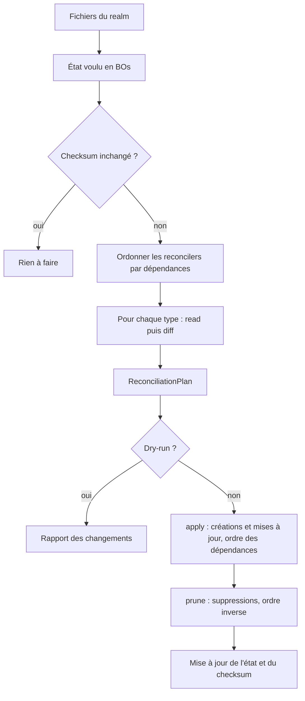

# ADR-004 — Moteur de réconciliation

## Statut

Accepté — refonte 7.0.0. Fusion des fichiers d'un realm et code de sortie du dry-run tranchés le 17/11/2026.

## Contexte

Aujourd'hui, `RealmImportService.updateRealm` appelle une vingtaine de `*ImportService` dans un ordre écrit à la main (`clientImportService` deux fois, `clientScopeImportService` trois fois). Chaque service crée, met à jour et parfois supprime en même temps. Les suppressions différées passent par `ExecutionContextHolder`, un singleton statique partagé par tous les realms et par les traitements parallèles (`import.parallel`). `cleanRealm` les exécute après l'import de tous les fichiers.

Conséquences : on ne peut pas savoir ce qui va changer avant de l'avoir fait, l'ordre est fragile, et le contexte global n'est pas isolé par realm.

## Décision

Un moteur unique, dans `application/reconcile/`, qui sépare **calculer** et **appliquer**.

### Le contrat d'un reconciler

```java
public interface Reconciler<T> {
    ResourceType type();
    Set<ResourceType> dependsOn();
    List<T> read(RealmContext context);                                // existant, via un port
    ChangeSet<T> diff(RealmContext context, List<T> desired, List<T> actual);
    void apply(RealmContext context, Change<T> change);                // création ou mise à jour
    void prune(RealmContext context, Change<T> deletion);              // suppression
}
```

- `read` lit l'existant par le port de la ressource et renvoie des BOs (ADR-002).
- `diff` s'appuie sur les règles du domaine : appariement par `ResourceKey`, comparaison des BOs, puis filtre des suppressions selon le mode géré (`full`, `no-delete`), l'état (ressources créées par l'outil) et les règles de protection (`protectedResources`).
- `apply` et `prune` exécutent une modification par le port.

### Le déroulement pour un realm



- **Ordre déclaratif.** Chaque reconciler déclare ses dépendances (`dependsOn`). Le moteur en déduit l'ordre par tri topologique, et échoue au démarrage en cas de cycle. Les suppressions se font dans l'ordre inverse.
- **Plan explicite.** `ReconciliationPlan` (domaine) liste toutes les modifications d'un realm : type, clé, nature (création, mise à jour, suppression), champs modifiés. Il sert à l'exécution, au rapport et au dry-run.
- **Lecture au fil de l'eau.** Le plan d'un type est calculé juste avant son application, parce qu'un type peut dépendre de ce que le précédent vient de créer (un client référence un client scope créé dans la même exécution). En dry-run, le moteur simule ces créations dans le `RealmContext`.
- **Contexte par realm.** `RealmContext` remplace `ExecutionContextHolder` : il est créé pour un realm, transmis explicitement, et ne survit pas à son exécution. Plus aucun état global modifiable.
- **Parallélisme.** `import.parallel` est conservé : les modifications d'un même type sans dépendance entre elles (clients, groupes de même niveau) peuvent s'appliquer en parallèle. Le `RealmContext` est sûr en accès concurrent.
- **Dry-run.** Nouvelle option (`import.dry-run=true`) : le moteur calcule et affiche le plan sans rien modifier.

### Plusieurs fichiers pour un même realm

Aujourd'hui, chaque fichier est appliqué l'un après l'autre, puis le nettoyage a lieu à la fin. Désormais, **les fichiers d'un realm sont fusionnés en un seul état voulu** avant le calcul du plan :

- les ressources de tous les fichiers sont réunies par type et par `ResourceKey` ;
- une même clé définie dans plusieurs fichiers avec un contenu identique est acceptée une fois ;
- une même clé définie avec des contenus différents est une erreur de configuration (code de sortie `2`), qui cite les fichiers en cause ;
- les paramètres du realm lui-même (`RealmRepresentation` hors ressources) suivent la même règle, champ par champ.

C'est un changement de comportement par rapport à la 6.x (où le dernier fichier l'emportait) : il est annoncé dans le CHANGELOG de la 7.0.0, avec un exemple de migration.

### Code de sortie du dry-run

`0` si rien ne changerait, `10` si des modifications sont en attente (comme `terraform plan -detailed-exitcode`), pour qu'une CI détecte une dérive. Voir ADR-005.

## Conséquences

- `RealmImportService`, `cleanRealm`, `ExecutionContextHolder` et `ThreadHelper` disparaissent à la fin de la migration.
- Les 20 `*ImportService` deviennent des reconcilers, migrés un par un. Pendant la migration, le moteur appelle les reconcilers migrés, et un reconciler « legacy » enveloppe les services pas encore migrés, à leur place dans l'ordre actuel.
- Les règles de diff, de protection et de mode géré passent dans le domaine et se testent sans Keycloak.
- Javers (utilisé aujourd'hui pour comparer) n'est plus nécessaire dans le domaine : la comparaison porte sur des records.
